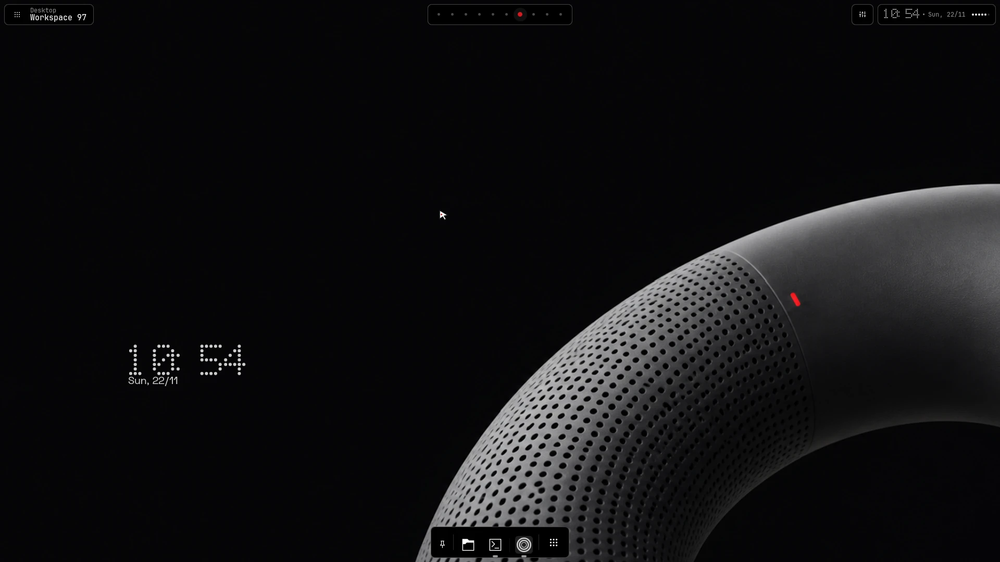
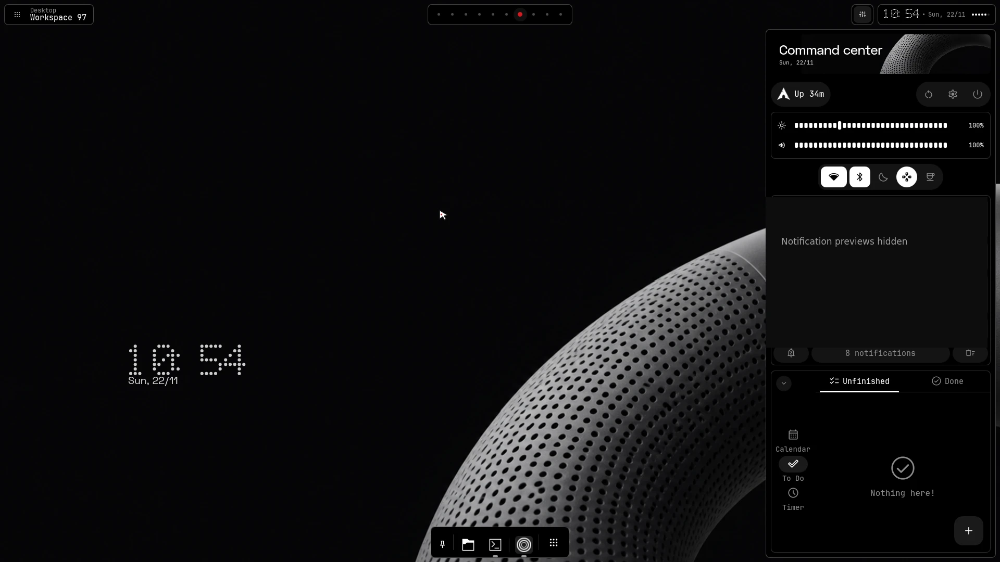
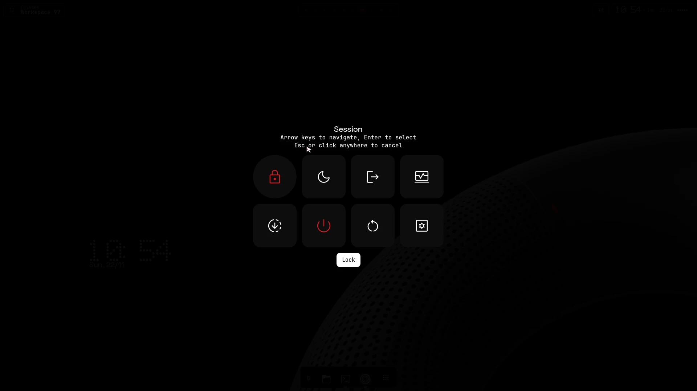
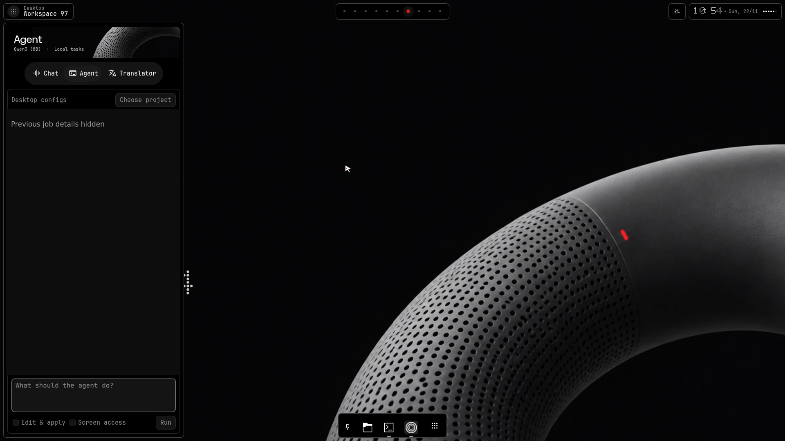

# ntg-hyprland

Nothing-inspired Hyprland dotfiles with a matte graphite and red palette, a Quickshell status bar and Command Center, themed terminals, and a local AI sidebar.

## Desktop gallery

| Command Center | Power menu |
| --- | --- |
|  |  |

## Install

On fresh Arch, run `./install.sh --arch` from a clone to install dependencies and apply the dotfiles. On a working Hyprland and illogical-impulse setup, preview the changes with `./install.sh --config-only --dry-run`, then run `./install.sh --config-only`.

The [installation guide](docs/INSTALL.md) covers prerequisites, first launch, Ollama, and restoring your configs from the installer backup.

## AI sidebar

Press **Super+A** to open Chat and the **Agent** tab. Install and start [Ollama](https://ollama.com/) and pull `qwen3:8b` for the default local model. The Agent also uses Python 3.11+, Git, ripgrep, and the Qt 6 and Lua syntax tools for config checks. Optional screen inspection uses `grim` and the local `gemma4:e4b` model.

See the [desktop guide](NOTHING_THEME.md) for palette maintenance, Agent permissions, Undo, and optional dictation.

## Credits

Big cheers to **end-4** and the illogical-impulse crew! 🎉 These dotfiles grew out of their Hyprland and Quickshell setup, and the **AI panel** deserves an extra round of applause. Their original AI sidebar gave me a place to start, and I had a blast giving it a graphite makeover and adding the local Agent tab. [Give end-4’s dotfiles a star!](https://github.com/end-4/dots-hyprland)

The bundled Kvantum theme adapts work by [Vince Liuice](https://github.com/vinceliuice/Colloid-kde) based on KvAdapta by Tsu Jan. See [GPL-3.0](LICENSE) and the [third-party license notices](licenses/).
