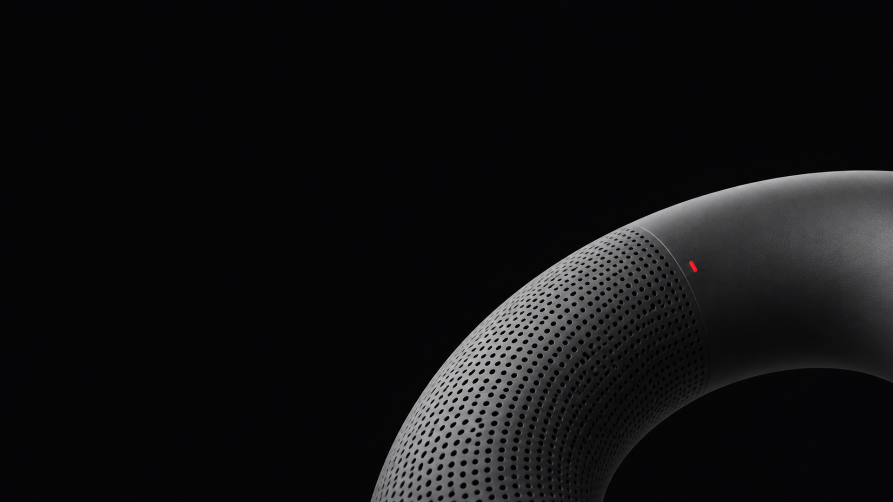

# ntg-hyprland

Nothing-inspired Hyprland dotfiles with a matte graphite and red palette, a Quickshell status bar and Command Center, themed terminals, and a local AI sidebar.



## Setup

This configuration uses Hyprland's Lua config and the Quickshell-based [illogical-impulse](https://github.com/end-4/dots-hyprland) desktop. Install the upstream desktop dependencies first. The config was tested on Arch Linux with Quickshell 0.2.1. The icon and cursor settings use Breeze Dark and Bibata Modern Classic as fallbacks.

Back up your existing dotfiles before copying the configuration and assets. Run these commands from the repository root.

```sh
mkdir -p "$HOME/.config" "$HOME/.local/share"
cp -a .config/. "$HOME/.config/"
cp -a .local/share/. "$HOME/.local/share/"
```

Start a Hyprland session or run `hyprctl reload` in an existing one. You can apply the bundled wallpaper in an existing session with this command.

```sh
"$HOME/.config/quickshell/ii/scripts/colors/switchwall.sh" --image "$HOME/.config/quickshell/ii/assets/images/default_wallpaper.png"
```

## AI sidebar

Press **Super+A** to open Chat and the **Agent** tab. Install and start [Ollama](https://ollama.com/) and pull `qwen3:8b` for the default local model. The Agent also uses Python 3.11+, Git, ripgrep, and the Qt 6 and Lua syntax tools for config checks. Optional screen inspection uses `grim` and the local `gemma4:e4b` model.

See the [desktop guide](NOTHING_THEME.md) for palette maintenance, Agent permissions, Undo, and optional dictation.

## Credits

The Hyprland and Quickshell base comes from [end-4/dots-hyprland](https://github.com/end-4/dots-hyprland). The bundled Kvantum theme adapts work by [Vince Liuice](https://github.com/vinceliuice/Colloid-kde) based on KvAdapta by Tsu Jan. See [GPL-3.0](LICENSE) and the [third-party license notices](licenses/).
